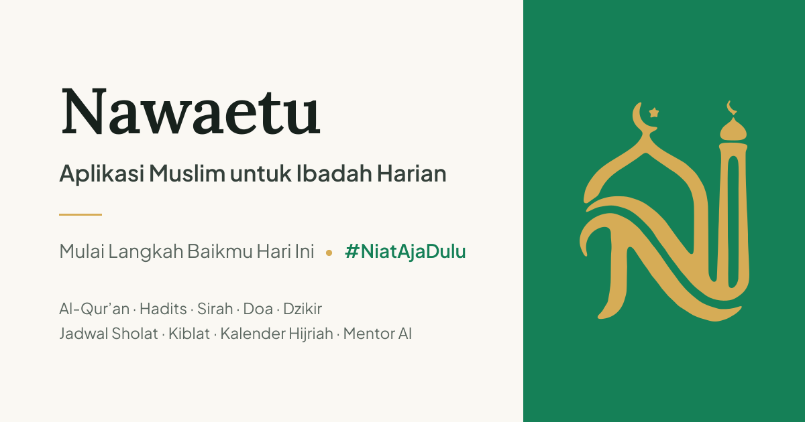
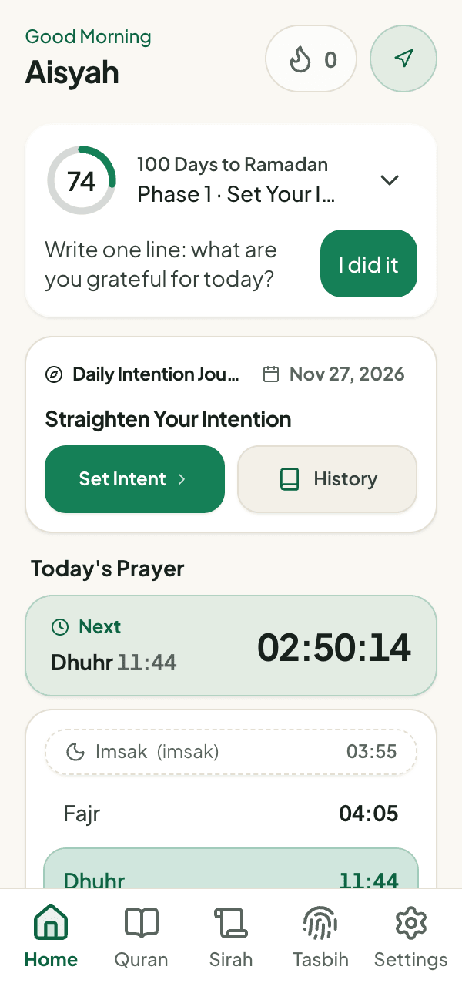
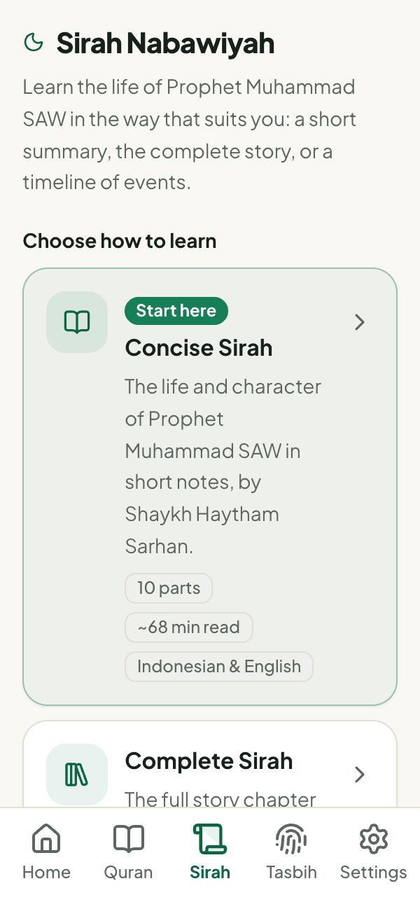
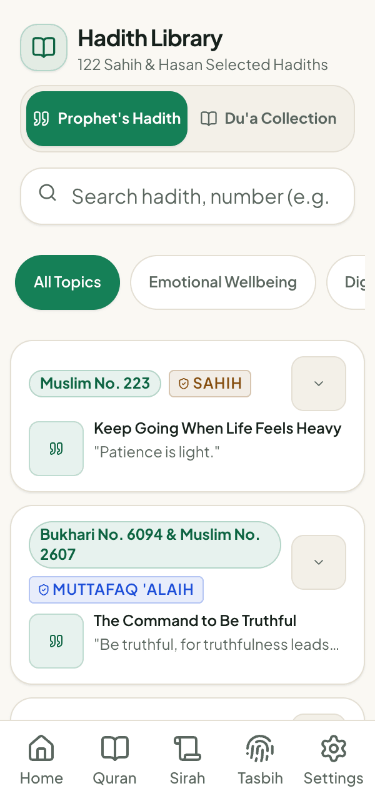
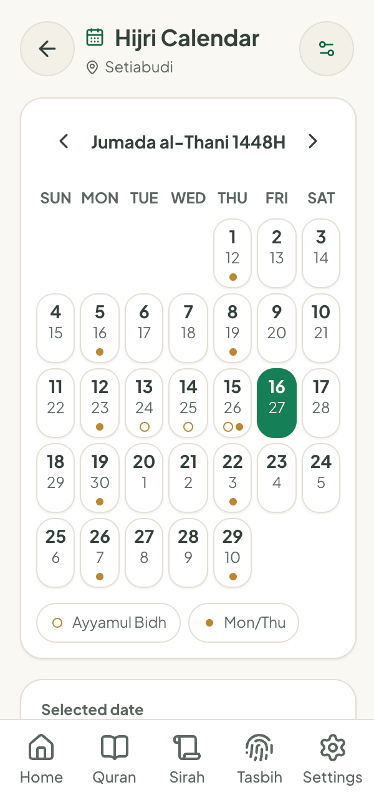

<p align="center">
  
</p>

<h1 align="center">Nawaetu</h1>

<p align="center"><b>Aplikasi Muslim yang dimulai dari niat.</b><br>
Al-Qur'an, sholat, hadits, dan Sirah yang bisa dicek sumbernya, dalam kebiasaan harian yang berangkat dari <i>niat</i>.</p>

<p align="center">
  <a href="https://nawaetu.com"><b>Buka nawaetu.com</b></a> ·
  <a href="README.md">Read in English</a> ·
  <a href="#ringkasan-pitch">Ringkasan pitch</a>
</p>

<p align="center">
  <a href="https://github.com/hadianr/nawaetu/releases"></a>
  <a href="LICENSE"></a>
  <a href="https://nawaetu.com"></a>
  
</p>

<p align="center">
  
</p>

---

<a name="ringkasan-pitch"></a>
## Ringkasan Pitch

| Topik | Ringkasan |
| :--- | :--- |
| **Satu kalimat** | Aplikasi Muslim gratis tanpa iklan yang menjadikan ibadah harian sebuah kebiasaan yang dimulai dari niat, dengan konten agama yang menampilkan sumbernya. |
| **Masalah** | Kebanyakan aplikasi Muslim berupa kotak perkakas: jam sholat di satu tempat, penghitung di tempat lain. Teks agama di internet sering dibagikan tanpa sumber, dan chatbot AI umum menjawab pertanyaan agama tanpa rujukan. |
| **Solusi** | Satu aplikasi yang menghubungkan niat, ibadah, dan belajar: niat pagi dan refleksi malam, jadwal sholat, kiblat, Al-Qur'an dengan tajwid dan audio, hadits dan doa dengan perawi dan derajat, Sirah dalam tiga format, serta asisten AI yang dirancang menyertakan rujukan. |
| **Keunggulan** | Desain yang dimulai dari niat, konten bersumber yang ditampilkan persis seperti aslinya, asisten yang menyatakan bila sumber belum dapat dipastikan, tanpa iklan, dan open source. |
| **Pasar** | Indonesia saja memiliki sekitar 246 juta Muslim (87% penduduk). Belanja konsumen Muslim global mencapai $2,6 triliun pada 2024. ([sumber](#mengapa-sekarang)) |
| **Traksi** | Live di nawaetu.com sejak 2026, 277 akun terdaftar, 825 misi diselesaikan, 90 rilis. ([detail](#sekilas)) |
| **Model bisnis** | Gratis bagi pengguna tanpa iklan. Didukung donasi, sponsor infrastruktur (Biznet Gio Cloud), dan lisensi komersial untuk organisasi. |
| **Founder** | Hadian Rahmat ([@hadianr](https://github.com/hadianr)) |

---

<a name="sekilas"></a>
## Sekilas Nawaetu

Angka per **20 November 2026**. Angka penggunaan diambil dari endpoint publik aplikasi [`/api/stats/global`](https://nawaetu.com/api/stats/global), sehingga bisa diperbarui untuk setiap deck.

| Bidang | Angka |
| :--- | :--- |
| **Akun terdaftar** | 277 (tamu memakai aplikasi tanpa akun dan tidak dihitung) |
| **Misi diselesaikan** | 825 |
| **Hari ibadah tercatat** | 69 |
| **Al-Qur'an** | 114 surah, audio per ayat, warna tajwid, terjemahan Indonesia dan Inggris |
| **Hadits dan doa** | 116 hadits sahih dan hasan pilihan serta 50 doa, masing-masing dengan perawi dan derajat |
| **Sirah** | 3 format: buku ringkas 10 bagian (dengan izin penulis), Sirah lengkap 50 bab, dan linimasa 13 bab |
| **Kehadiran di pencarian** | 591 halaman terindeks di sitemap, dengan halaman konten yang dirender di server dan `llms.txt` untuk pencarian AI |
| **Pengembangan** | 90 rilis bertag dan 1.295 commit sejak Januari 2026 |
| **Kualitas** | 153 file test (984 test), batas coverage baris 80% di CI, pemindaian CodeQL, dan uji browser dengan Anoa |
| **Aksesibilitas** | Teks tombol, teks aksen, dan warna status memenuhi WCAG AA di kelima tema (diuji otomatis), dengan fokus keyboard yang terlihat |
| **Bahasa** | Indonesia dan Inggris |
| **Platform** | Aplikasi web (PWA yang bisa dipasang) dan Android wrapper di repositori ini |
| **Harga** | Gratis, tanpa iklan |

---

## Masalah

1. **Alat ibadah tersebar.** Jadwal sholat, Al-Qur'an, dzikir, dan puasa biasanya ada di aplikasi terpisah atau di sudut yang berbeda dalam satu aplikasi, tanpa ada yang menghubungkannya menjadi kebiasaan harian.
2. **Konten agama sering tanpa sumber.** Hadits dan kutipan beredar tanpa perawi atau derajat, sehingga pembaca tidak bisa mengecek apa yang mereka bagikan.
3. **AI menjawab tanpa rujukan.** Chatbot umum menjawab pertanyaan agama dengan yakin, tanpa menunjukkan ayat atau hadits yang menjadi dasarnya.
4. **Semangat mudah pudar.** Penghitung mencatat angka, tetapi tidak mencatat *mengapa* seseorang beribadah.

## Solusi

Nawaetu membangun hari pengguna di atas tiga gagasan.

| Pilar | Wujudnya di aplikasi |
| :--- | :--- |
| **Niat** | Menetapkan niat setiap pagi dan berefleksi setiap malam. Misi, streak, dan rank Hasanah (Mubtadi sampai Muhsinin) menghargai konsistensi, bukan sekadar hitungan. |
| **Ilmu yang bisa dicek** | Al-Qur'an, hadits, doa, dan Sirah menampilkan sumber, perawi, dan derajatnya, serta menjaga teks dari penerbit lain persis seperti aslinya. Tanya Nawaetu, asisten AI-nya, dirancang menyertakan rujukan dan menyatakan bila sumber belum dapat dipastikan. |
| **Ibadah harian** | Jadwal sholat berbasis GPS dengan pengingat, kompas kiblat, kalender Hijriah dengan hari puasa sunnah, tasbih berantai dengan mode fokus, dan panduan Ramadhan musiman. |

<a name="mengapa-sekarang"></a>
## Mengapa Sekarang

| Sinyal | Angka | Sumber |
| :--- | :--- | :--- |
| Muslim di Indonesia | 245.973.915 orang, 87,08% penduduk (semester I 2024) | [Databoks, mengutip data kependudukan](https://databoks.katadata.co.id/en/demographics/statistics/66b45dd8e5dd0/the-majority-of-indonesias-population-is-muslim-in-the-first-half-of-2024) |
| Belanja konsumen Muslim global | $2,6 triliun pada 2024, diproyeksikan $3,56 triliun pada 2029 | [State of the Global Islamic Economy 2025/26, DinarStandard](https://www.dinarstandard.com/our-impact/state-of-the-global-islamic-economy-report) |
| Permintaan aplikasi Muslim | Muslim Pro melewati 150 juta unduhan di seluruh dunia (2023) | [Siaran pers Bitsmedia](https://prnewswire.com/apac/news-releases/singapore-based-bitsmedia-announces-significant-milestone-with-150-million-downloads-for-its-global-lifestyle-app-301853984.html) |

Nawaetu dimulai dari pengguna berbahasa Indonesia dan Inggris, pasar mayoritas Muslim terbesar, dan dibangun agar bisa dicek di saat makin banyak orang bertanya kepada AI tentang agamanya.

---

## ✨ Produk

Tangkapan layar asli dari aplikasi di [nawaetu.com](https://nawaetu.com) (ukuran HP). Tersedia lima tema; Daylight adalah tema bawaan dan Emerald adalah tema gelap.

| Beranda: niat dan jadwal sholat | Al-Qur'an dengan audio | Sirah dalam tiga format |
| :---: | :---: | :---: |
|  |  |  |
| **Hadits dengan perawi dan derajat** | **Kalender Hijriah dan hari puasa** | **Tasbih (tema gelap Emerald)** |
|  |  |  |

---

## Apa yang Membuat Nawaetu Berbeda?

Banyak aplikasi Islam berfokus pada utilitas seperti jadwal sholat dan penghitung tasbih. Nawaetu mempertahankan alat-alat itu dan membangun di sekitar niat di balik setiap ibadah.

| Aspek | Aplikasi utilitas (cth. Muslim Pro) | Nawaetu |
| :--- | :--- | :--- |
| **Fokus utama** | Jadwal sholat, penghitung, pengingat | **Niat lebih dulu**: alasan di balik ibadahmu |
| **Refleksi** | Penghitung dan pengingat pasif | **Jurnal Muhasabah**: niat pagi, refleksi malam |
| **Konten agama** | Bervariasi menurut aplikasi | **Sumber ditampilkan bersama teksnya**: perawi, derajat, dan tautan, persis seperti aslinya |
| **Tanya jawab Islami** | Artikel dan pencarian teks | **Tanya Nawaetu**: asisten AI yang dirancang menyertakan rujukan Al-Qur'an dan hadits, dan menyatakan bila sumber belum dapat dipastikan |
| **Motivasi** | Penghitung dan streak | **Sistem Hasanah**: progres rank (Mubtadi sampai Muhsinin) dan streak Istiqamah |
| **Iklan** | Bervariasi menurut aplikasi dan paket | Tanpa iklan |
| **Kode sumber** | Umumnya closed-source | Open source (AGPLv3) |

---

## Milestone

| Waktu | Milestone |
| :--- | :--- |
| Januari 2026 | Commit pertama |
| 2026 | Aplikasi web live di nawaetu.com: jurnal niat, misi, rank Hasanah, check-in sholat, Al-Qur'an, hadits dan doa, tasbih, alat puasa dan Ramadhan |
| Oktober 2026 | Halaman konten dirender di server untuk mesin pencari dan pencarian AI (`llms.txt`, data terstruktur) |
| November 2026 | Sirah dalam tiga format, termasuk buku ringkas Syaikh Haytham Sarhan yang diterbitkan dengan izin tertulis beliau |
| November 2026 | Penyegaran brand: logo dan set ikon vektor datar, tema terang sebagai bawaan, sistem dua font, dan kontras WCAG AA di setiap tema |

## Roadmap

Ini langkah berikutnya yang sudah tercatat di repositori ini, bukan komitmen bertanggal.

- **Toko aplikasi**: menerbitkan aplikasi Android (wrapper-nya ada di [`android/`](android/)) dan menulis deskripsi toko.
- **Verifikasi hadits**: mengecek nomor hadits di perpustakaan terhadap [Sunnah.com](https://sunnah.com).
- **Kecepatan**: memuat pemutar animasi setelah tampilan pertama agar beranda lebih cepat di HP.
- **Ramadhan 1448 H**: mengaktifkan panduan Ramadhan untuk musimnya; perjalanan 100 hari menuju Ramadhan sudah berjalan.

## Model Bisnis dan Keberlanjutan

- **Gratis bagi pengguna, tanpa iklan**: alat ibadah tidak dikunci di balik pembayaran.
- **Donasi**: GitHub Sponsors, Trakteer, Ko-fi, dan Buy Me a Coffee ([Dukung Misi Nawaetu](#-dukung-misi-nawaetu)).
- **Sponsor infrastruktur**: [Biznet Gio Cloud](https://www.biznetgio.com/) menyediakan server cloud untuk nawaetu.com.
- **Dual license**: AGPLv3 untuk komunitas, dengan lisensi komersial untuk organisasi yang membutuhkan kode privat atau white-label ([Lisensi](#-lisensi-dual-licensing)).

## Tim

**Hadian Rahmat**, founder dan maintainer. Kontak: [hadian.rahmat@gmail.com](mailto:hadian.rahmat@gmail.com).

---

## 📑 Daftar Isi
- [Pilar Utama & Fitur](#-pilar-utama--fitur)
- [Performa](#-performa)
- [Sumber Konten](#-sumber-konten)
- [FAQ](#faq)
- [Tech Stack](#️-tech-stack)
- [Memulai](#-memulai)
- [Kontribusi](#-kontribusi)
- [Dukung Misi Nawaetu](#-dukung-misi-nawaetu)
- [Lisensi](#-lisensi-dual-licensing)

## 🌟 Pilar Utama & Fitur

### 1. 🎯 Pembinaan Berbasis Niat
*   **Jurnal Niat**: Tetapkan "Niat" setiap pagi dan refleksi di malam hari (Muhasabah Jiwa). Refleksi malam memuat ayat tentang menunaikan amanah, berlaku adil, memeriksa berita sebelum membagikannya, dan berbicara lemah lembut (QS 4:58, 5:8, 49:6, 20:44).
*   **Tanya Nawaetu**: Asisten Islami yang dirancang mendasarkan jawaban pada Al-Qur'an, Sunnah, dan Hadits beserta rujukan, serta mengakui batasnya bila sumber belum dapat dipastikan.
    *   **Pertanyaan seputar politik tanpa memihak**: dijawab dengan prinsip Islam (amanah, keadilan, syura, tabayyun) dan pendapat-pendapat utama para ulama. Tanya Nawaetu tidak pernah mendukung atau menolak partai, calon, tokoh, undang-undang, atau aksi tertentu.
    *   **Paham bahasa Gen Z**: mengerti istilah sehari-hari seperti *privilege*, *ordal*, *bagi-bagi kue*, *cawe-cawe*, *buzzer*, *pencitraan*, *politik identitas*, *serangan fajar*, *apatis*, *oposisi*, dan *rezim*.
*   **Gamifikasi Ibadah**: Kumpulkan Niat Points melalui misi harian yang bermakna, termasuk misi opsional untuk mendoakan pemimpin dan negeri.

### 2. 📖 Konten Spiritual Terpadu
*   **Al-Qur'an Digital**: Mode Mushaf & List dengan audio per ayat, pewarnaan Tajwid, dan standar Mushaf Kemenag RI.
*   **Hub Hadits & Doa**: Konten pilihan harian dengan terjemahan Bahasa Indonesia dan Inggris, dikelompokkan menurut topik sehari-hari.
    *   **Amanah & Kepemimpinan**: hadits sahih tentang tanggung jawab, keadilan, menyuarakan kebenaran, suap, dan korupsi, yang bisa dicari dengan kata-kata yang dipakai anak muda (misalnya *cawe-cawe*, *serangan fajar*, *buzzer*).
*   **Sirah Nabawiyah**: tiga cara mempelajari perjalanan hidup Nabi Muhammad SAW, dengan bahasa bacaan yang bisa diatur terpisah dari bahasa aplikasi.
    *   **Ringkasan Sirah**: buku singkat Syaikh Haitsam Sarhan tentang sejarah dan kepribadian Nabi Muhammad SAW, dalam bahasa Indonesia dan Inggris. Dimuat tanpa diubah dengan izin penulis, dibaca per bagian, dan progresnya tersimpan di perangkat.
    *   **Sirah Lengkap**: 50 bab dari *Ar-Rahiq al-Makhtum* (terjemahan Indonesia), dengan sumber dan nomor halaman yang dicantumkan.
    *   **Lini Masa Peristiwa**: 13 bab berurutan, dari sebelum kenabian hingga wafatnya beliau. Setiap bab merangkai hadits sahih dengan kalimat penghubung singkat, menampilkan perawi dan derajat setiap hadits, dan hanya diberi tanggal bila teks Sirah menyebutkannya.
*   **Feed Spiritual**: Widget Daily Spirit, Quote of the Day, dan Hadits harian.

### 3. 🕌 Presisi Ritual
*   **Adzan Presisi Tinggi**: Jadwal sholat berbasis GPS dengan akurasi notifikasi < 60 detik.
*   **Kompas Kiblat**: Penunjuk arah presisi berbasis sensor perangkat.
*   **Kalibrasi Hijriah**: Penyesuaian tanggal yang fleksibel sesuai dengan pengamatan hilal lokal.

### 4. 📈 Alat Konsistensi (Istiqamah)
*   **Tasbih 2.0**: Penghitung canggih dengan mode Berantai (Sequential), bacaan Kustom, dan Mode Zen OLED.
*   **Check-in Sholat**: Pelacak ritual presisi tinggi dengan opsi jamaah/sendiri.
*   **Dashboard Ibadah**: Statistik seumur hidup, milestone, dan visualisasi tren Hasanah.

### 5. 🗓️ Pendamping Puasa & Amalan Musiman
*   **Puasa Sunnah & Sukarela**: Pelacak puasa Senin-Kamis, Ayyamul Bidh, dan puasa kustom dengan status berbasis fiqih dan reward Hasanah.
*   **Peristiwa Hijriah & Musiman**: Pelacakan presisi untuk milestone kalender Islam, pengamatan hilal, dan panduan amalan musiman. Kalender Hijriah juga menampilkan "Sejarah di Bulan Ini", misalnya Perang Badar di bulan Ramadhan serta Perang Uhud, Khandaq, dan Hunain di bulan Syawal.
*   **Mode Ramadhan**: Panduan Fiqh khusus, rekomendasi Sahur & Buka Puasa sesuai Sunnah, serta hitung mundur yang aktif secara dinamis di Bulan Suci.

---

## ⚡ Performa

Ibadah tidak boleh terganggu lag, jadi performa dijaga lewat:

- ✅ **Fully Static / ISR**: 114 halaman surah dibangun statis lewat `generateStaticParams`.
- ✅ **Header keamanan statis**: CSP, HSTS, dan lainnya didefinisikan di konfigurasi Next.js, bukan dijalankan per request.
- ✅ **Strategi sesi JWT**: tidak ada lookup database per request untuk validasi sesi.
- ✅ **Code splitting**: kode yang tidak dipakai di-tree-shake.
- ✅ **Optimasi gambar**: AVIF/WebP dengan lazy loading dan minimum TTL 1 tahun.
- ✅ **Efisiensi crawl**: sitemap dan robots melewatkan halaman private.

---

## 📚 Sumber Konten

Konten agama harus bisa dicek. Nawaetu menampilkan asal setiap teks, dan menjaga teks dari penerbit lain persis seperti yang mereka terbitkan.

| Konten | Sumber | Keterangan |
| :--- | :--- | :--- |
| Hadits Amanah & Kepemimpinan, bab Lini Masa Peristiwa | [HadeethEnc.com](https://hadeethenc.com) | Teks Arab, terjemahan Indonesia dan Inggris, perawi, serta derajat ditampilkan tanpa diubah, dengan tautan ke setiap hadits |
| Ayat refleksi malam | [QuranEnc.com](https://quranenc.com) | Terjemahan Kementerian Agama RI dan Saheeh International, tanpa diubah |
| Ringkasan Sirah | *Catatan Penting Seputar Sejarah dan Kepribadian Rasulullah* karya Syaikh Haitsam Sarhan ([IslamHouse](https://islamhouse.com/id/books/2831882), [sarhaan.com](https://sarhaan.com/ab/a-concise-biography-of-the-prophet-peace-be-upon-him-and-his-special-traits/)) | Diterjemahkan ke bahasa Indonesia oleh Abdul Aziz Firdaus dan Mufassir Arif, ke bahasa Inggris oleh Ibraheem Abu Tameem Al-Mubtasim. Ditampilkan tanpa diubah, dengan izin tertulis dari penulis |
| Sirah Lengkap | Dataset Sirah Nabawiyah ([Bagian 1](https://doi.org/10.17632/mwmzf8c2r5.1), [Bagian 2](https://doi.org/10.17632/zvn9cjn8nh.1), CC BY 4.0) | Berdasarkan *Ar-Rahiq al-Makhtum* karya Syaikh Shafiyyurrahman al-Mubarakfuri (terjemahan Indonesia) |
| Teks dan audio Al-Qur'an | [Quran.com](https://quran.com), Kemenag | Murattal oleh Mishary Rashid Al-Afasy |

Judul, tadabbur, pengantar bab, dan kalimat penghubung ditulis oleh Nawaetu, diberi keterangan demikian, dan hanya merangkum isi sumbernya. Nomor hadits di perpustakaan hadits masih menunggu verifikasi dengan [Sunnah.com](https://sunnah.com).

Lisensi Nawaetu (AGPLv3 dan lisensi komersial) mencakup kode dan tulisan Nawaetu sendiri. Konten dari penerbit di atas tetap mengikuti ketentuan masing-masing.

---

## FAQ

**Apa itu Nawaetu?**
Aplikasi pelacak kebiasaan Islami gratis yang berangkat dari niat, dengan Al-Qur'an, alat ibadah, hadits dan doa bersumber, Sirah, alat puasa dan Ramadhan, dzikir, serta asisten AI.

**Apakah Nawaetu gratis?**
Ya. Aplikasi dapat digunakan gratis, dan kode sumbernya terbuka di bawah AGPLv3.

**Apakah bisa dipakai tanpa internet?**
Beberapa fitur dapat diakses tanpa koneksi internet.

**Bagaimana Tanya Nawaetu menjawab pertanyaan agama?**
Dirancang untuk menyertakan rujukan pada jawaban agama dan mengakui batasnya bila sumber belum dapat dipastikan. Ini tidak menggantikan ulama yang kompeten.

**Bahasa apa yang didukung?**
Indonesia dan Inggris.

**Dari mana konten agamanya berasal?**
Dari sumber yang diterbitkan: hadits dari HadeethEnc, terjemahan Al-Qur'an melalui QuranEnc, Ringkasan Sirah dari buku Syaikh Haitsam Sarhan (dengan izin beliau), dan Sirah Lengkap dari dataset yang dicantumkan sumbernya, berdasarkan *Ar-Rahiq al-Makhtum*. Setiap konten menampilkan sumbernya. Lihat [Sumber Konten](#-sumber-konten).

**Apakah Nawaetu memihak dalam politik?**
Tidak. Konten Amanah & Kepemimpinan dan Tanya Nawaetu mengajarkan prinsip dari Al-Qur'an dan Sunnah, tanpa pernah menyebut atau mendukung partai, calon, maupun pejabat tertentu.

---

## 🛠️ Tech Stack

Versi dikunci di [`package.json`](package.json).

### Core Framework
*   **Next.js** (App Router) - Meta-framework React utama
*   **TypeScript** - Arsitektur type-safe yang ketat
*   **React** - Fitur concurrent & Server Components terbaru

### Backend & Database
*   **Drizzle ORM** - Type-safe SQL database query
*   **PostgreSQL (Supabase)** - Database serverless melalui transaction pooler
*   **NextAuth v5** - Sesi autentikasi aman
*   **Upstash Redis & Rate Limiting** - Proteksi dan pembatasan rate API terdistribusi
*   **Firebase Admin SDK** - Infrastruktur push notification
*   **cron-job.org** - Penjadwalan prayer-alert dan streak reminder

### AI & External APIs
*   **Google Gemini** (`@google/generative-ai`)
*   **Groq (Llama)** - Inferensi LLM kecepatan tinggi
*   **Aladhan API** (Jadwal Sholat GPS)
*   **Quran.com API** (Mushaf Uthmani & Audio Murottal)

### UI, Styling & Experience
*   **Design system**: Lora (display) dan Plus Jakarta Sans (UI) lewat `next/font`, Amiri untuk teks Arab, 5 tema di atas token bersama dengan test kontras WCAG AA, dan semua ikon dibuat dari satu logo vektor (`npm run icons`, `npm run og-image`)
*   **Tailwind CSS v4** & **Shadcn UI** (Primitif Radix UI)
*   **Framer Motion** - Animasi mulus & mikro-interaksi
*   **Recharts** - Analitik dinamis & grafik tren Hasanah
*   **Lucide React** & **Sonner** - Ikonografi & notifikasi toast
*   **Next PWA (`@ducanh2912/next-pwa`)** - Progressive Web App yang dapat diinstal

### Monitoring & Kualitas
*   **Sentry** - Pelacakan error real-time & pemantauan performa
*   **Vercel Speed Insights** - Real User Performance Monitoring
*   **Vitest** - Pengujian unit dan integrasi

---

## 🚀 Memulai

### Untuk Pengguna
1. Buka [nawaetu.com](https://nawaetu.com)
2. Izinkan akses lokasi untuk jadwal sholat
3. Mulai isi niat harian dan selesaikan misi
4. Opsional: pasang sebagai PWA (tambahkan ke layar utama)

### Untuk Developer

**Prasyarat:**
- Node.js 24.x
- npm (repositori memakai `package-lock.json`)
- Git

**Instalasi:**
```bash
# Clone repository
git clone https://github.com/hadianr/nawaetu.git
cd nawaetu

# Install dependencies
npm ci

# Salin environment variables lalu isi sesuai kebutuhan
cp .env.example .env.local

# Jalankan development server
npm run dev
# Buka http://localhost:3000
```

**Skrip yang tersedia:**
```bash
npm run dev          # Development server
npm run build        # Build produksi (webpack)
npm run start        # Jalankan server produksi
npm run lint         # ESLint
npm run typecheck    # Validasi TypeScript
npm run test:run     # Seluruh test (Vitest)
npm run analyze      # Analisis ukuran bundle
```

## 🚀 Deployment

### Live Demo
- 🌐 **Production**: [nawaetu.com](https://nawaetu.com)
- 📊 **Vercel Dashboard**: [Vercel Console](https://vercel.com)

### Auto-Deployment Pipeline

**Trigger Events:**
```
Push ke main branch
    ↓
Vercel: Auto-Build & Test
    ↓
Vercel: Auto-Deploy (production)
    ↓
Live pada nawaetu.com ✅
```

**Deployment Flow:**
1. Code pushed ke GitHub `main` branch
2. Vercel automatically triggers build & test
3. Jika build success ✅
4. Vercel automatically deploy to production (~2-5 min)
5. Deploy logs bisa dilihat di Vercel dashboard

### Deployment Status

| Environment | URL | Status |
|---|---|---|
| **Production** | https://nawaetu.com | 🟢 Active |
| **Preview** | Each PR → Vercel preview URL | 🟢 Auto-generated |

### Preview Deployments

Setiap Pull Request otomatis mendapat **preview URL**:

```
PR #123 → https://nawaetu-pr-123.vercel.app

Gunakan untuk testing sebelum merge!
```

### Monitoring & Performance

- **Vercel Analytics**: Response time, error tracking, performance metrics
- **Vercel Build Logs**: Real-time build output dan error tracking
- **Automatic Rollback**: Jika issue, mudah di-revert via Vercel dashboard

---

## 📱 PWA Installation

Nawaetu bisa diinstall kayak native app:

**Android:**
1. Buka nawaetu.com di Chrome
2. Tap menu (3 titik) → "Install app"
3. Done! Icon muncul di home screen

**iOS:**
1. Buka nawaetu.com di Safari
2. Tap Share button → "Add to Home Screen"
3. Done! Launch dari home screen

---

## 🤝 Kontribusi

Kami sangat menyambut kontribusi dari seluruh komunitas global! Baik berupa perbaikan bug, fitur baru, dokumentasi, maupun terjemahan.

Harap pelajari [Code of Conduct](CODE_OF_CONDUCT.md) kami sebelum berkontribusi.
Untuk melaporkan bug atau mengajukan ide fitur baru, silakan gunakan [GitHub Issue Templates](https://github.com/hadianr/nawaetu/issues/new/choose). Panduan kontribusi lengkap dapat dibaca di [CONTRIBUTING.id.md](CONTRIBUTING.id.md) (Bahasa Indonesia) atau [CONTRIBUTING.md](CONTRIBUTING.md) (English).

**Ketentuan konten:** dalam teks yang ditulis Nawaetu sendiri, sebut Nabi secara lengkap sebagai "Nabi Muhammad SAW" (Indonesia) atau "Prophet Muhammad SAW" (Inggris), tidak memakai ligatur ﷺ atau "Nabi SAW" saja. Teks yang disalin dari sumber berlisensi seperti HadeethEnc dan QuranEnc harus tetap persis seperti aslinya. Aturan ini dijaga oleh test (`src/data/honorific.test.ts`) dan [AGENTS.md](AGENTS.md).

**Cara Berkontribusi:**
1. **Fork** repositori ini
2. **Buat branch fitur** (`git checkout -b feature/amazing-feature`)
3. **Commit perubahan** (`git commit -m 'feat: add amazing feature'`)
4. **Push ke branch** (`git push origin feature/amazing-feature`)
5. **Buat Pull Request**

---

## 🎨 Brand Assets

### Hashtags
`#NiatAjaDulu` `#Nawaetu` `#BuildHabits` `#IslamicGamification` `#IbadahHabits` `#StreakKeeper` `#DailyMissions` `#LevelUpIman` `#IstiqomahDaily` `#HabitTracker` `#MuslimTech`

### Social Media
- Website: [nawaetu.com](https://nawaetu.com)
- Instagram: [@nawaetuapp](https://instagram.com/nawaetuapp) (coming soon)
- Twitter: [@nawaetuapp](https://twitter.com/nawaetuapp) (coming soon)
- GitHub: [hadianr/nawaetu](https://github.com/hadianr/nawaetu)

---

## 📦 Alur Rilis (Release Workflow)

Maintainer dapat melakukan rilis versi baru menggunakan script otomatis:
```bash
./scripts/release.sh v1.X.Y
```
Script ini akan secara otomatis memperbarui versi pada `package.json`, `package-lock.json`, `src/config/app-config.ts`, badge `README.md` dan `README.id.md`, serta memperbarui `CHANGELOG.md`.

Untuk panduan lengkap dan troubleshooting, baca [Panduan Alur Rilis](docs/RELEASE_WORKFLOW.md).

---

## 📋 Project Structure

```
nawaetu/
├── src/
│   ├── app/              # Next.js app pages
│   ├── components/       # React components
│   ├── context/          # React context providers
│   ├── data/             # Static data & translations
│   ├── hooks/            # Custom React hooks
│   ├── lib/              # Utility functions & helpers
│   └── instrumentation.ts
├── public/               # Static assets
├── .github/
│   └── workflows/        # GitHub Actions CI/CD
├── .env.example          # Environment variables template
├── CHANGELOG.md          # Version history
├── package.json
└── README.md
```

---

## 💬 Support

Punya pertanyaan atau feedback? Reach out:
- 📧 Email: support@nawaetu.com
- 💬 In-app: Tanya Nawaetu (Asisten Muslim AI)
- 🐛 Issues: [GitHub Issues](https://github.com/hadianr/nawaetu/issues)
- 💬 Discussions: [GitHub Discussions](https://github.com/hadianr/nawaetu/discussions)

---


## ☕ Dukung Misi Nawaetu

Nawaetu adalah proyek open-source untuk umat. Dukungan Anda membantu menutupi biaya server (database, hosting) dan mempercepat pengembangan fitur baru.

### ☁️ Sponsor Infrastruktur
Kami sangat berterima kasih atas dukungan dari **[Biznet Gio Cloud](https://www.biznetgio.com/)**, yang telah bermurah hati menyediakan infrastruktur server cloud berkinerja tinggi untuk menenagai Nawaetu.com.

[](https://www.biznetgio.com/)

*Apakah perusahaan Anda tertarik mendukung teknologi open-source Islami? Jadilah sponsor untuk menampilkan logo/brand Anda di sini dan bantu kami mengembangkan aplikasi Nawaetu untuk umat global! Hubungi [hadian.rahmat@gmail.com](mailto:hadian.rahmat@gmail.com).*

### 💖 Platform Donasi
| Platform | Link |
| :--- | :--- |
| **GitHub Sponsors** | [](https://github.com/sponsors/hadianr) |
| **Trakteer** | [](https://trakteer.id/hadianr) |
| **Ko-fi** | [](https://ko-fi.com/hadianr) |
| **Buy Me a Coffee** | [](https://buymeacoffee.com/hadianr) |

### 🏢 Lisensi Komersial
*Untuk kebutuhan bisnis, white-label, atau penggunaan closed-source.*

| Tingkat | Harga | Keuntungan |
| :--- | :--- | :--- |
| **Standar** | **$500** / tahun | 1 Produk, Source Code Privat, Update Reguler |
| **Perpetual** | **$1,500** sekali bayar | Lisensi Selamanya, Whitelabel, Priority Support |

👉 [**Mulai via GitHub Sponsors**](https://github.com/sponsors/hadianr)

Semoga Allah membalas kebaikan Anda dengan keberkahan. Jazakumullah Khairan Katsiran! 🤲

---

<a name="lisensi"></a>
## 📄 Lisensi (Dual Licensing)

**Nawaetu** menerapkan model **Dual Licensing** untuk menjaga keberlanjutan proyek dan melindungi komunitas:

### 1. Edisi Komunitas (Gratis & Open Source)
Berlisensi di bawah **AGPLv3 (GNU Affero General Public License v3)**.
- ✅ Gratis digunakan, dimodifikasi, dan didistribusikan.
- ⚠️ Jika Anda memodifikasi dan mendistribusikan (termasuk menjalankannya sebagai layanan SaaS), **Anda WAJIB membuka source code Anda** di bawah lisensi AGPLv3.
- **Cocok untuk**: Individu, komunitas, belajar, dan kontribusi open source.

### 2. Lisensi Komersial (Berbayar/White Label)
Untuk perusahaan atau individu yang ingin menggunakan Nawaetu untuk **tujuan komersial**, **white-label**, atau **tanpa membuka source code**.
- ✅ Source code tetap privat (tidak perlu open source).
- ✅ Boleh rebranding (White Label).
- ✅ Priority support & fitur enterprise.
- 📩 Kontak: **hadian.rahmat@gmail.com** untuk harga dan detail.
- 📖 Baca ketentuan lengkap: [COMMERCIAL_LICENSE.md](COMMERCIAL_LICENSE.md)

Lihat file [LICENSE](LICENSE) untuk teks lengkap AGPLv3.

---

## 👤 Author

**Hadian Rahmat**
- GitHub: [@hadianr](https://github.com/hadianr)
- Email: [hadian.rahmat@gmail.com](mailto:hadian.rahmat@gmail.com)

---

## 🙏 Acknowledgments

- Murattal by Mishary Rashid Al-Afasy
- Quran API by [Quran.com](https://quran.com)
- Hadith texts and translations by [HadeethEnc.com](https://hadeethenc.com)
- Concise Sirah by Shaykh Haytham Sarhan, published with his permission
- Quran translations via [QuranEnc.com](https://quranenc.com)
- Prayer times calculation by [Aladhan API](https://aladhan.com)
- Icons by [Lucide Icons](https://lucide.dev)
- UI Components by [shadcn/ui](https://ui.shadcn.com)
- AI powered by [Google Gemini](https://gemini.google.com) & [Groq](https://groq.com)

----

**"Innama al-a'malu bin-niyyat" - Start with intention, end with blessings.**

**#LuruskanNiat #BuildHabits #IstiqomahDaily #HasanahPoints**

Let's make ibadah easier, one niat at a time. 🚀🌙

---

*Terakhir diperbarui: 15 November 2026*
