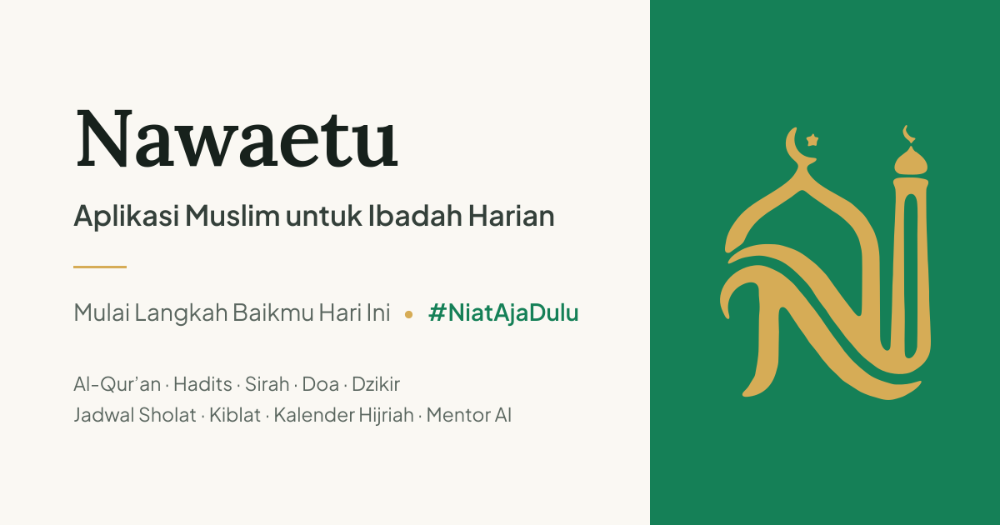
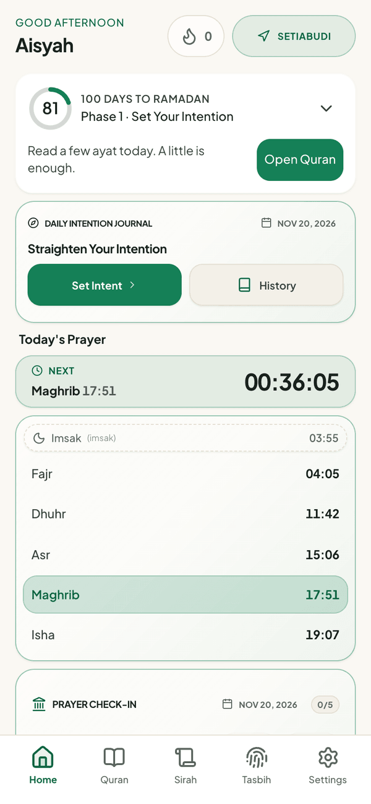
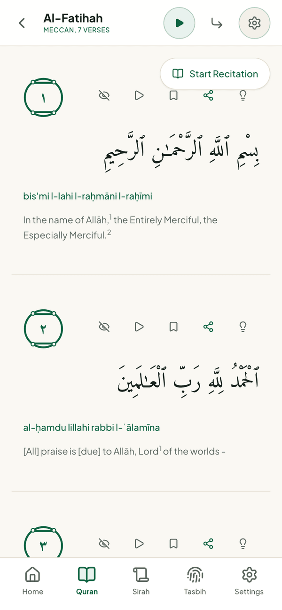
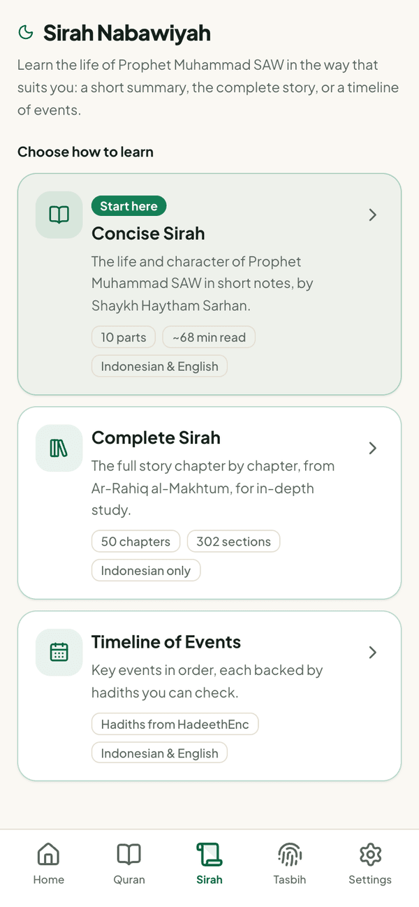
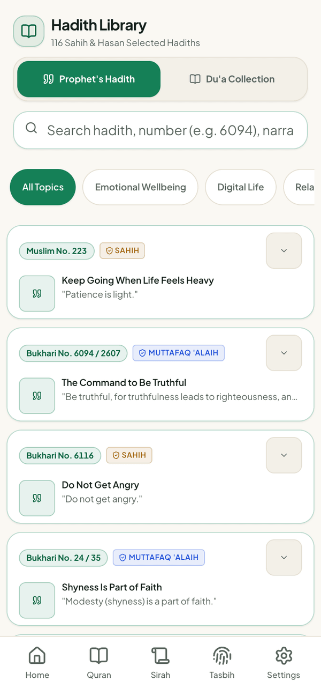
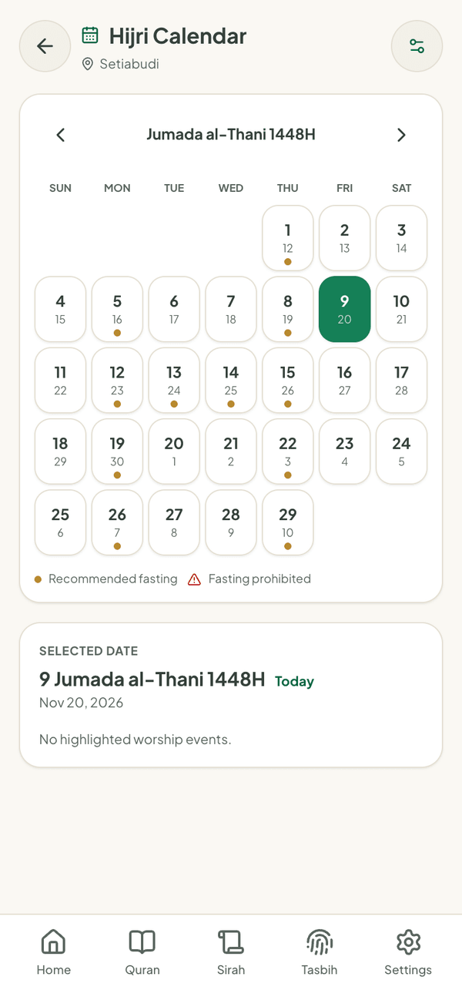
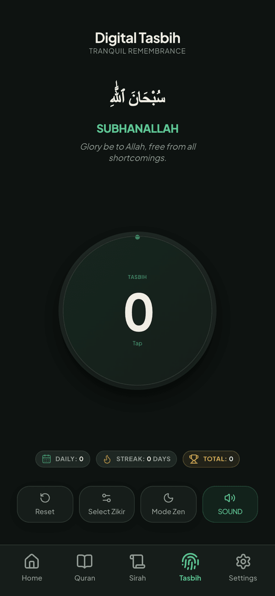

<p align="center">
  
</p>

<h1 align="center">Nawaetu</h1>

<p align="center"><b>The Muslim app that starts with intention.</b><br>
Quran, prayer, hadith and Sirah you can check, and a daily habit built around <i>niat</i>.</p>

<p align="center">
  <a href="https://nawaetu.com"><b>Open nawaetu.com</b></a> ·
  <a href="README.id.md">Baca dalam Bahasa Indonesia</a> ·
  <a href="#pitch-summary">Pitch summary</a>
</p>

<p align="center">
  <a href="https://github.com/hadianr/nawaetu/releases"></a>
  <a href="LICENSE"></a>
  <a href="https://nawaetu.com"></a>
  
</p>

<p align="center">
  
</p>

---

<a name="pitch-summary"></a>
## Pitch Summary

| Topic | Summary |
| :--- | :--- |
| **One line** | A free, ad-free Muslim app that turns daily worship into a habit that starts with intention (*niat*), with religious content that shows its sources. |
| **Problem** | Most Muslim apps are toolboxes: a prayer clock here, a counter there. Religious text online is often shared without a source, and general AI chatbots answer religious questions without citing anything. |
| **Solution** | One app that links intention, worship and learning: a morning intention and evening reflection, prayer times, Qibla, a Quran with tajweed and audio, hadith and duas with attribution and grade, Sirah in three formats, and an AI assistant designed to cite references. |
| **Why it stands out** | Intention-first design, source-backed content shown exactly as published, an assistant that says when it cannot confirm a source, no ads, and open source. |
| **Market** | Indonesia alone has about 246 million Muslims (87% of the population). Global Muslim consumer spending was $2.6 trillion in 2024. ([sources](#market)) |
| **Traction** | Live at nawaetu.com since 2026, 277 registered accounts, 825 missions completed, 90 releases. ([details](#traction)) |
| **Business model** | Free for users with no ads. Sustained by donations, an infrastructure sponsor (Biznet Gio Cloud), and a commercial license for organisations. |
| **Founder** | Hadian Rahmat ([@hadianr](https://github.com/hadianr)) |

---

## At a Glance

<a name="traction"></a>
Figures as of **20 November 2026**. Usage numbers come from the app's public endpoint [`/api/stats/global`](https://nawaetu.com/api/stats/global), so they can be refreshed for any deck.

| Area | Figure |
| :--- | :--- |
| **Registered accounts** | 277 (guests use the app without an account and are not counted) |
| **Missions completed** | 825 |
| **Worship days logged** | 69 |
| **Quran** | All 114 surahs, verse-by-verse audio, tajweed colours, Indonesian and English translations |
| **Hadith and dua** | 116 selected sahih and hasan hadith and 50 duas, each with attribution and grade |
| **Sirah** | 3 formats: a 10-part concise book (with the author's permission), a 50-chapter complete Sirah, and a 13-chapter timeline |
| **Search presence** | 591 indexable pages in the sitemap, with server-rendered content pages and `llms.txt` for AI search |
| **Delivery** | 90 tagged releases and 1,295 commits since January 2026 |
| **Quality** | 153 test files (984 tests), an 80% line-coverage gate in CI, CodeQL scanning, and browser checks with Anoa |
| **Accessibility** | Button text, accent text and status colours meet WCAG AA in all 5 themes (automated test), with visible keyboard focus |
| **Languages** | English and Indonesian |
| **Platforms** | Web app (installable PWA) and an Android app wrapper in this repository |
| **Price** | Free, with no advertising |

---

## The Problem

1. **Worship tools are scattered.** Prayer times, Quran, dhikr and fasting usually live in separate apps or separate corners of one app, with nothing connecting them to a daily habit.
2. **Religious content often has no source.** Hadith and quotes circulate without attribution or grade, so readers cannot check what they share.
3. **AI answers without references.** General chatbots answer religious questions confidently, without pointing to the Quran or hadith they rely on.
4. **Motivation fades.** Counters track numbers, but not *why* someone worships.

## The Solution

Nawaetu builds the day around three ideas.

| Pillar | What it means in the app |
| :--- | :--- |
| **Intention (niat)** | Set an intention every morning and reflect every evening. Missions, streaks and the Hasanah rank (Mubtadi to Muhsinin) reward consistency, not just counts. |
| **Knowledge you can check** | Quran, hadith, duas and Sirah show their source, attribution and grade, and keep other publishers' text exactly as published. Tanya Nawaetu, the AI assistant, is designed to cite references and to say when a source cannot be confirmed. |
| **Everyday worship** | GPS prayer times with reminders, Qibla compass, Hijri calendar with recommended fasting days, tasbih with sequences and a focus mode, and seasonal Ramadan tools. |

<a name="market"></a>
## Why Now

| Signal | Figure | Source |
| :--- | :--- | :--- |
| Muslims in Indonesia | 245,973,915 people, 87.08% of the population (first half of 2024) | [Databoks, citing Indonesia's civil registry](https://databoks.katadata.co.id/en/demographics/statistics/66b45dd8e5dd0/the-majority-of-indonesias-population-is-muslim-in-the-first-half-of-2024) |
| Global Muslim consumer spending | $2.6 trillion in 2024, projected $3.56 trillion by 2029 | [State of the Global Islamic Economy 2025/26, DinarStandard](https://www.dinarstandard.com/our-impact/state-of-the-global-islamic-economy-report) |
| Demand for Muslim apps | Muslim Pro passed 150 million downloads worldwide (2023) | [Bitsmedia press release](https://prnewswire.com/apac/news-releases/singapore-based-bitsmedia-announces-significant-milestone-with-150-million-downloads-for-its-global-lifestyle-app-301853984.html) |

Nawaetu starts with Indonesian and English speakers, the largest Muslim-majority market, and is built to be checkable at a time when more people ask AI about their faith.

---

## Product

Real screenshots of the live app at [nawaetu.com](https://nawaetu.com) (phone size). Five themes are available; Daylight is the default and Emerald is the dark theme.

| Home: intention and prayer times | Quran with audio | Sirah in three formats |
| :---: | :---: | :---: |
|  |  |  |
| **Hadith with attribution and grade** | **Hijri calendar and fasting days** | **Tasbih (Emerald dark theme)** |
|  |  |  |

---

## What Makes Nawaetu Different?

Many Islamic apps centre on utilities such as prayer schedules and tasbih counters. Nawaetu keeps those tools and builds around the intention behind each act of worship.

| Aspect | Utility-first apps (e.g. Muslim Pro) | Nawaetu |
| :--- | :--- | :--- |
| **Core focus** | Prayer times, counters, reminders | **Intention first**: the reason behind your worship |
| **Reflection** | Counters and passive reminders | **Muhasabah journal**: morning intention, evening reflection |
| **Religious content** | Varies by app | **Source shown with the text**: attribution, grade and a link, kept exactly as published |
| **Islamic Q&A** | Articles and text search | **Tanya Nawaetu**: AI assistant designed to cite Quran and hadith references and to say when a source cannot be confirmed |
| **Motivation** | Counters and streaks | **Hasanah system**: rank progression (Mubtadi to Muhsinin) and Istiqamah streaks |
| **Ads** | Varies by app and plan | No advertising |
| **Source code** | Typically closed | Open source (AGPLv3) |

---

## Milestones

| When | Milestone |
| :--- | :--- |
| January 2026 | First commit |
| 2026 | Web app live at nawaetu.com: intention journal, missions, Hasanah ranks, prayer check-in, Quran, hadith and dua, tasbih, fasting and Ramadan tools |
| October 2026 | Content pages server-rendered for search and AI search (`llms.txt`, structured data) |
| November 2026 | Sirah in three formats, including Shaykh Haytham Sarhan's concise book published with his written permission |
| November 2026 | Brand refresh: a flat vector logo and icon set, a light default theme, a two-font system, and WCAG AA contrast in every theme |

## Roadmap

These are next steps already identified in this repository, not commitments with dates.

- **App stores**: publish the Android app (the wrapper is in [`android/`](android/)) and write store listings.
- **Hadith verification**: check hadith numbers in the library against [Sunnah.com](https://sunnah.com).
- **Speed**: load the animation player after the first paint to cut mobile load time on the home page.
- **Ramadan 1448 H**: switch on the Ramadan guide for the season; the 100-days-to-Ramadan journey is already live.

## Business Model and Sustainability

- **Free for users, no ads**: worship tools are not paywalled.
- **Donations**: GitHub Sponsors, Trakteer, Ko-fi and Buy Me a Coffee ([Support the Mission](#-support-the-mission)).
- **Infrastructure sponsor**: [Biznet Gio Cloud](https://www.biznetgio.com/) provides the cloud servers behind nawaetu.com.
- **Dual license**: AGPLv3 for the community, with a commercial license for organisations that need private source or white-labelling ([License](#-license)).

## Team

**Hadian Rahmat**, founder and maintainer. Contact: [hadian.rahmat@gmail.com](mailto:hadian.rahmat@gmail.com).

---

## Table of Contents
- [Core Pillars & Features](#-core-pillars--features)
- [Content Sources](#-content-sources)
- [FAQ](#faq)
- [Tech Stack](#️-tech-stack)
- [Getting Started](#-getting-started)
- [Contributing](#-contributing)
- [Support the Mission](#-support-the-mission)
- [License](#-license)

## 🌟 Core Pillars & Features

### 1. 🎯 Intention-First Cultivation
*   **Intention Journal**: Set your "Niat" every morning and reflect in the evening (Soul-Muhasabah). The evening reflection includes verses on keeping trusts, justice, checking news before sharing it, and speaking gently (Quran 4:58, 5:8, 49:6, 20:44).
*   **Tanya Nawaetu**: An Islamic assistant designed to ground answers in the Quran, Sunnah, and Hadith with references, and to acknowledge its limits when a source cannot be confirmed.
    *   **Civic questions without taking sides**: political questions are answered with Islamic principles (trust, justice, consultation, checking news) and the main scholarly views. It never endorses or rejects a party, candidate, figure, law, or protest.
    *   **Speaks Gen Z**: understands everyday terms such as *privilege*, *ordal*, *bagi-bagi kue*, *cawe-cawe*, *buzzer*, *pencitraan*, *politik identitas*, *serangan fajar*, *apatis*, *oposisi*, and *rezim*.
*   **Gamified Growth**: Earn Niat Points through intention-based missions, including an optional daily mission to pray for leaders and the country.

### 2. 📖 Spiritual Content Engine
*   **Digital Quran**: Mushaf & List mode with verse-by-verse audio, Tajweed colors, and authentic Kemenag standards.
*   **Hadith & Dua Hub**: Curated daily content with English and Indonesian translations, grouped by everyday topics.
    *   **Civic Life & Leadership (Amanah & Kepemimpinan)**: authentic hadith on responsibility, justice, speaking up, bribery, and corruption, searchable with the words young people use (for example *cawe-cawe*, *serangan fajar*, *buzzer*).
*   **Sirah Nabawiyah**: three ways to learn the life of Prophet Muhammad SAW, with a reading language you can set apart from the app language.
    *   **Concise Sirah**: Shaykh Haytham Sarhan's short book on the life and character of Prophet Muhammad SAW, in English and Indonesian. It is published unchanged with the author's permission and read part by part, with progress saved on the device.
    *   **Complete Sirah**: 50 chapters from *Ar-Rahiq al-Makhtum* (Indonesian translation), with its source and page references credited.
    *   **Timeline of Events**: 13 chronological chapters, from before prophethood to his passing. Each chapter links authentic hadith with short connecting lines, shows each hadith's attribution and grade, and is dated only where the Sirah text states the date.
*   **Spiritual Feed**: Daily Spirit, Quote of the Day, and Hadith-of-the-day widgets.

### 3. 🕌 Ritual Precision
*   **High-Precision Adhan**: GPS-based prayer times with < 60s notification accuracy.
*   **Qibla Compass**: Sensor-based high-accuracy direction finder.
*   **Hijri Calibration**: Flexible date adjustments to align with local moon sightings.

### 4. 📈 Consistency (Istiqamah) Tools
*   **Tasbih 2.0**: Advanced counter with Sequential (Berantai), Custom readings, and OLED Zen Mode.
*   **Prayer Check-in**: High-precision ritual tracker with mosque/solo options.
*   **Ibadah Dashboard**: Lifetime statistics, milestones, and Hasanah trend visualizers.

### 5. 🗓️ Fasting & Seasonal Companion
*   **Sunnah & Voluntary Fasting**: Track Monday/Thursday (Senin-Kamis), Ayyamul Bidh, and custom fasting with fiqh-based statuses and Hasanah rewards.
*   **Seasonal & Hijri Events**: Precision tracking for Islamic calendar milestones, moon sightings, and seasonal spiritual guides. The Hijri calendar also shows "This Month in the Sirah", such as Badr in Ramadan and Uhud, the Trench, and Hunayn in Shawwal.
*   **Ramadhan Mode**: Specialized Fiqh guides, Sahur/Iftar Sunnah recommendations, and countdown timers dynamically activated during the Holy Month.

---

## 📚 Content Sources

Religious content should be checkable. Nawaetu shows where each text comes from, and keeps text from other publishers exactly as they published it.

| Content | Source | Notes |
| :--- | :--- | :--- |
| Civic Life hadith, Timeline of Events chapters | [HadeethEnc.com](https://hadeethenc.com) | Arabic, Indonesian, and English text, attribution, and grade shown unchanged, with a link to each hadith |
| Evening reflection verses | [QuranEnc.com](https://quranenc.com) | Ministry of Religious Affairs (Kemenag) Indonesian translation and Saheeh International, unchanged |
| Concise Sirah | *A Concise Biography of the Prophet and His Special Traits* by Shaykh Haytham Sarhan ([sarhaan.com](https://sarhaan.com/ab/a-concise-biography-of-the-prophet-peace-be-upon-him-and-his-special-traits/), [IslamHouse](https://islamhouse.com/id/books/2831882)) | English translation by Ibraheem Abu Tameem Al-Mubtasim; Indonesian translation by Abdul Aziz Firdaus and Mufassir Arif. Shown unchanged, with the author's written permission |
| Complete Sirah | Sirah Nabawiyah datasets ([Part 1](https://doi.org/10.17632/mwmzf8c2r5.1), [Part 2](https://doi.org/10.17632/zvn9cjn8nh.1), CC BY 4.0) | Based on *Ar-Rahiq al-Makhtum* by Shaykh Safiur Rahman al-Mubarakpuri (Indonesian translation) |
| Quran text and audio | [Quran.com](https://quran.com), Kemenag | Murattal by Mishary Rashid Al-Afasy |

Titles, reflections, chapter introductions, and connecting lines are written by Nawaetu, are labelled as such, and only summarise what their sources say. Hadith numbers in the hadith library are pending verification against [Sunnah.com](https://sunnah.com).

Nawaetu's licences (AGPLv3 and the commercial license) cover its own code and writing. Content from the publishers above remains under their own terms.

---

## FAQ

**What is Nawaetu?**
A free Islamic habit tracker that starts from intention (*niat*), with a Quran, prayer tools, hadith and dua with sources, Sirah, fasting and Ramadan tools, dhikr, and an AI assistant.

**Is Nawaetu free?**
Yes. The app is free to use, and the source code is open under AGPLv3.

**Does it work offline?**
Some features are available without an internet connection.

**How does Tanya Nawaetu answer religious questions?**
It is designed to include references in religious answers and to acknowledge its limits when a source cannot be confirmed. It does not replace a qualified scholar.

**Which languages are supported?**
English and Indonesian.

**Where does the religious content come from?**
From published sources: hadith from HadeethEnc, Quran translations via QuranEnc, the Concise Sirah from Shaykh Haytham Sarhan's book (with his permission), and the Complete Sirah from a credited dataset based on *Ar-Rahiq al-Makhtum*. Each item shows its source. See [Content Sources](#-content-sources).

**Does Nawaetu take political sides?**
No. The civic content and Tanya Nawaetu teach principles from the Quran and Sunnah and never name or support a party, candidate, or official.

---

## 🛠️ Tech Stack

Versions are pinned in [`package.json`](package.json).

### Core Framework
*   **Next.js** (App Router)
*   **TypeScript** - Strict type-safe architecture
*   **React** - Server Components and concurrent features

### Backend & Database
*   **Drizzle ORM** - Type-safe SQL database queries
*   **PostgreSQL (Supabase)** - Serverless database via the transaction pooler
*   **NextAuth v5** - Authentication layer
*   **Upstash Redis & Rate Limiting** - Distributed API protection
*   **Firebase Admin SDK** - Push notification infrastructure
*   **cron-job.org** - Scheduled prayer-alert and streak notifications

### AI & External APIs
*   **Google Gemini** (`@google/generative-ai`)
*   **Groq (Llama)** - High-speed LLM inference
*   **Aladhan API** (GPS Prayer Times)
*   **Quran.com API** (Uthmani Mushaf & Audio Recitations)

### UI, Styling & Experience
*   **Design system**: Lora (display) and Plus Jakarta Sans (UI) via `next/font`, Amiri for Arabic, 5 themes on shared tokens with a WCAG AA contrast test, and every icon generated from one vector mark (`npm run icons`, `npm run og-image`)
*   **Tailwind CSS v4** & **Shadcn UI** (Radix UI primitives)
*   **Framer Motion** - Animations & micro-interactions
*   **Recharts** - Analytics & Hasanah trends
*   **Lucide React** & **Sonner** - Iconography & toast notifications
*   **Next PWA (`@ducanh2912/next-pwa`)** - Installable Progressive Web App

### Monitoring & Quality
*   **Sentry** - Error tracking & performance monitoring
*   **Vercel Speed Insights** - Real User Performance Monitoring
*   **Vitest** - Unit and integration testing

---

## 🚀 Getting Started

### Prerequisites
- Node.js 24.x
- npm (the repository uses `package-lock.json`)

### Installation

```bash
# Clone repository
git clone https://github.com/hadianr/nawaetu.git
cd nawaetu

# Install dependencies
npm ci

# Setup environment variables
cp .env.example .env.local

# Run development server
npm run dev
```

Open [http://localhost:3000](http://localhost:3000) to view the app.

## 📦 Release Workflow

Maintainers can publish releases using the automated release script:
```bash
./scripts/release.sh v1.x.x
```
This updates `package.json`, `package-lock.json`, `src/config/app-config.ts`, badges, and `CHANGELOG.md`. For full details, see the [Release Workflow Guide](docs/RELEASE_WORKFLOW.md).

---

## 🤝 Contributing

We welcome contributions from the global community! Whether it's bug fixes, new features, or translations.

Please review our [Code of Conduct](CODE_OF_CONDUCT.md) before contributing to ensure a welcoming and inclusive environment.
To report bugs or suggest new features, please submit an issue using our [Issue Templates](https://github.com/hadianr/nawaetu/issues/new/choose). For complete guidelines, read [CONTRIBUTING.md](CONTRIBUTING.md).

1. **Fork** the repository
2. **Create feature branch** (`git checkout -b feature/AmazingFeature`)
3. **Commit changes** (`git commit -m 'feat: add amazing feature'`)
4. **Push to branch** (`git push origin feature/AmazingFeature`)
5. **Open Pull Request**

**Content conventions:** in text Nawaetu writes itself, name the Prophet in full as "Prophet Muhammad SAW" (English) or "Nabi Muhammad SAW" (Indonesian), never the ligature ﷺ or "the Prophet SAW" alone. Text copied from licensed sources such as HadeethEnc and QuranEnc must stay exactly as published. A test (`src/data/honorific.test.ts`) and [AGENTS.md](AGENTS.md) enforce this.

> 💡 **AI Assistant Note**: This repository supports local rules, workflows, and skills for AI coding assistants (Google Antigravity, Cursor, Claude Code) under `.agents/`.


## ☕ Support the Mission

Nawaetu is an open-source project built for the Ummah. Your support helps cover server costs (database, hosting) and fuels further development.

### ☁️ Infrastructure Sponsor
We are incredibly grateful to be supported by **[Biznet Gio Cloud](https://www.biznetgio.com/)**, who generously provides the high-performance cloud server infrastructure powering Nawaetu.com.

[](https://www.biznetgio.com/)

*Is your company interested in supporting Islamic open-source tech? Become a sponsor to have your logo featured here and help us scale Nawaetu for the global Ummah! Reach out to [hadian.rahmat@gmail.com](mailto:hadian.rahmat@gmail.com).*

### 💖 Donation Platforms
| Platform | Link |
| :--- | :--- |
| **GitHub Sponsors** | [](https://github.com/sponsors/hadianr) |
| **Trakteer** | [](https://trakteer.id/hadianr) |
| **Ko-fi** | [](https://ko-fi.com/hadianr) |
| **Buy Me a Coffee** | [](https://buymeacoffee.com/hadianr) |

### 🏢 Commercial Licensing
*For businesses, white-labeling, or proprietary use cases.*

| Tier | Pricing | Benefits |
| :--- | :--- | :--- |
| **Standard** | **$500** / year | 1 Product, Private Source, Regular Updates |
| **Perpetual** | **$1,500** once | Lifetime License, Whitelabel, Priority Support |

👉 [**Get Started via GitHub Sponsors**](https://github.com/sponsors/hadianr)

May Allah reward your generosity with goodness. Jazakumullah Khairan Katsiran! 🤲

---


<a name="license"></a>
## 📄 License

**Nawaetu** adopts a **Dual Licensing** model to ensure sustainability and protect the open-source community:

### 1. Community Edition (Free & Open Source)
Licensed under **AGPLv3 (GNU Affero General Public License v3)**.
- ✅ Free to use, modify, and distribute.
- ⚠️ If you modify and distribute (or run as a service), **you must open-source your code** under AGPLv3.
- Best for: Individuals, non-profits, and open-source contributions.

### 2. Commercial License (Proprietary)
For companies or individuals who wish to use Nawaetu for **commercial purposes**, **white-label**, or **without open-sourcing their code**.
- ✅ Private source code (no open-source requirement).
- ✅ White labeling allowed.
- ✅ Priority support & enterprise features.
- 📩 Contact: **hadian.rahmat@gmail.com** for pricing and details.
- 📖 Read the full terms: [COMMERCIAL_LICENSE.md](COMMERCIAL_LICENSE.md)

See the [LICENSE](LICENSE) file for the full AGPLv3 text.

---

## 👤 Author

**Hadian Rahmat**
- Email: [hadian.rahmat@gmail.com](mailto:hadian.rahmat@gmail.com)
- GitHub: [@hadianr](https://github.com/hadianr)

---

**"Start with intention, end with blessings."**

Let's make worship easier, one intention at a time. 🚀🌙
